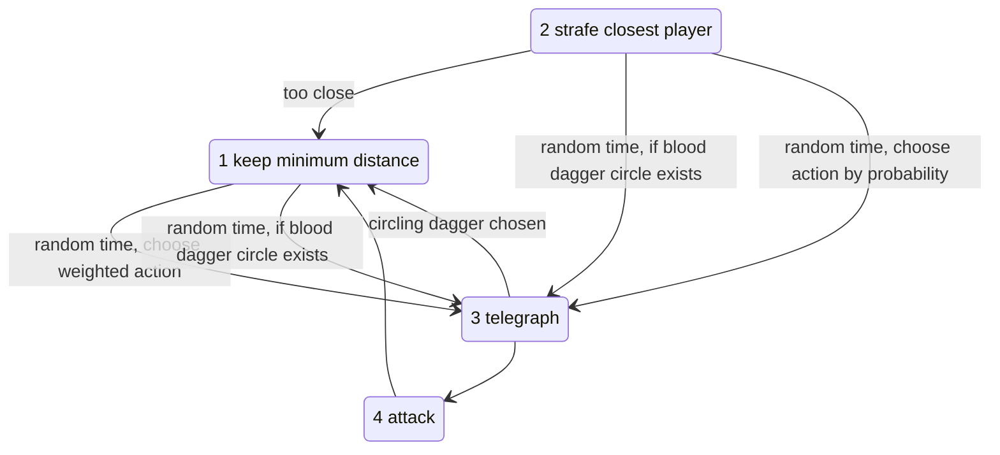

# Bosses

## Miniboss: Death High Priest (dungeon 1)

**Status:** Decided

**Who:** an elf, a hermit member of the death cult and its former leader (the former leader of the religion of death). A crazed elf, maybe the leader of the "Death Cult" (name pending). See [story.md](../story.md).

**The fight:** goblin waves coming out of holes in the wall.
- **Phase 1:** he has goblins that give him a shield and don't respawn. He throws daggers while he has the shield.
- **Phase 2:** when all goblins are gone, the shield is gone and new goblins start coming. While recharging, he occasionally kills goblins to cast attacks, until he has accumulated enough for his shield again.
- The sacrifice attacks are purple/red death-magic daggers. They only look different and otherwise work the same.
- **He flees and survives** (Decided): the players beat him, but he gets away. That's why the end boss has none of his skills; it only carries the souls of those who died.

### Attacks

- Single swipe melee attack.
- Dagger cone.
- Needs a goblin sacrifice: 12 blood daggers in all directions, at the goblin's location.
- Needs a goblin sacrifice: 3 blood daggers circle a random player.
- Needs a goblin sacrifice: gain a shield.

### Movement

- Moves slowly, strafing the nearest player and trying to hold distance (weak priority to hold distance).
- Occasionally (or at certain HP damage) sacrifices a goblin to teleport.

### Behavior

### Weighted action choice

Point system: assign points to each action, then divide each action's points by the total to get its probability.

| Action | Rules |
|---|---|
| Melee swipe | has shield +5, too close +5, too far: set to 0 |
| Teleport | too close +5, no shield +5, far enough −5, no goblin: set to 0 |
| Dagger cone | too close and has shield +5, far enough +10, no goblin +5 |
| Dagger explosion | too close −10, has shield +5, far enough +10, no goblin: set to 0 |
| 3 circling daggers | too close −10, has shield +5, far enough +10, no goblin: set to 0 |
| Shield | too close −5, far enough +10, no shield +10, has shield: set to 0 |

**Open:** is it weird that the circling daggers appear before the sacrifice (during the channeling/telegraph)?

**Built:**
- [MiniBossDeathHighPriest.gd](../../Scripts/Enemies/MiniBossDeathHighPriest.gd) has 9 HP.
- The decision brain is [StateThinking.gd](../../Scripts/StateMachine/StatesEnemy/MiniBossDeathHighPriest/StateThinking.gd). It uses base weights plus distance and shield modifiers, close to the table above.
- Sacrifice attacks mark a minion when their telegraph starts and kill it when the ability goes off (`StateTelegraphSacrifice`).
- He teleports every time his HP drops to a multiple of 3.
- The whip does nothing to him, since it is found after this fight.
- In the map's MiniBossRoom:
  - The doors close once both players are inside.
  - An `EnemySpawner` brings goblins from 4 points.
  - When everything is dead, the whip chest appears and the door opens.
- Known bug: the dagger circling breaks when he is interrupted by damage (TODO in the script).
- **Differs from the design:** in the game he still dies at 0 HP (the room's `EnemyCounter` counts his death to make the whip chest appear). Making him flee instead is a to-do.

## End boss: dungeon 1

**Status:** Draft, not built. Parts marked Decided are settled; the rest is a worked-out proposal.

**Concept:** a creature born from the living beings the players killed in this dungeon. This is the chalice idea that "enemies come back as one big dungeon monster at the end of each dungeon run" ([items.md](items.md#chalice-of-death)). Working name: **Severed Amalgam**.

**Lore:** nobody dies a natural death anymore since the death god is gone. Beings killed by violence or accidents become Severed, monsters that reflect their defining aspects. The end boss is the Severed born from this dungeon's dead. Being born from many deaths doesn't make it one of the rare [human-like Severed](../story.md#human-like-severed-name-pending): it is an ordinary, brainless one.

Two layers shape it:
- **What** the souls were (goblin, wizard, elite wizard) gives it **parts and attacks**.
- **Who** they were (their [soul personalities](../story.md#soul-personalities)) gives it **extra features**.

### Decided

- **All parts, every run.** The players are forced to kill every monster in this dungeon, so the boss always has the parts of every monster type: goblin, wizard and elite wizard.
- **No Death High Priest skills.** He fled and survived, so his soul isn't part of it.
- **Signature trait: "Nowhere to go".** A Severed's soul has nowhere to go, and only the chalice can end a monster that otherwise can't be killed ([story.md](../story.md#the-blood-chalice-and-the-death-god)).
  - At 0 HP it doesn't die. It collapses into a pulsing **soul core** and becomes invulnerable.
  - Interacting with the core opens the **chalice choice**.
  - If nobody interacts within about 15 s, it **reforms** with ⅓ HP and no parts, which shows the players that it really can't die.
  - Only the chalice ends it.
- **Ending (first version).** A simple chalice choice, saved for later dungeons, with no reward or consequence yet:
  - kill it with the chalice (story: a reward, but the death god grows stronger; the bad ending path)
  - entrap it (story: no reward, some monster outbreaks later; the good ending path)
  - Afterwards it fades out (red when killed, blue when entrapped), the arena gate opens and the exit lever appears.

### Appearance

**Status:** Open. How the boss is created or appears is not decided yet.
- Rejected: the dead bodies crawling together and fusing into one.
- Placeholder for a first prototype: it simply waits dormant in the arena until the room wakes.

### Arena

**Status:** Draft

- **"ChiefRoom"**: the area behind MainHallway's 2nd locked door (the chief room from the concept sketch: "chief room, bossfight?"). The exit lever is already there.
- The room wakes only when both players are inside. Then a gate closes behind them.
- The exit lever stays hidden until the chalice choice is made.

### Fight

**Status:** Draft. Starting numbers to tune in play: about 24 HP, slow walk.

| HP | Parts left | What changes |
|---|---|---|
| 100% | goblin, wizard, elite | all attacks |
| 75% | goblin, wizard | the elite part breaks off and becomes a Wizard; blink is gone |
| 50% | goblin | the wizard part breaks off and becomes a Wizard; fireballs are gone |
| 25% | none | the goblin part breaks off and becomes 2 Goblins; claw and spit are gone; only the bare core with slow lunges is left |
| 0% | – | "Nowhere to go": it collapses into the soul core |

- **Armored body.** Hits only do damage while the core is exposed:
  - for 2 s after a **whip** hit, which also stuns it. The dungeon item is the key to the fight.
  - during the stagger when a part breaks off
  - always, once all parts are gone
  - Player 2 can shoot the exposed core from range while player 1 keeps the boss busy.
- **Attacks by part**, each telegraphed and picked by a weighted brain like the miniboss's:
  - **Goblin part:** a big claw swipe in front of it, and spitting out 2 Severed goblins (at most 3 alive).
  - **Wizard part:** a fan of 5 fireballs toward the closest player.
  - **Elite part:** blinks to a teleport point away from the players.
- Between attacks it walks slowly toward the closest player.

### Personality features

**Status:** Draft. These come from the [soul personalities](../story.md#soul-personalities) of the killed souls. They are instincts, not intelligence; the boss stays brainless.

A feature is active when enough of the killed souls had that personality (a threshold of 1 for now, so the system also works later with NPC souls). Every monster type in this dungeon has all three, so in dungeon 1 all three are always active.

- **Greedy: steals potions.**
  - A telegraphed grab. On a hit it does damage and takes the potion out of a full bottle (the bottle becomes empty). With no full bottle, the grab only does damage.
  - It hoards the stolen potions and gives one back each time a part breaks off.
- **Lust: preys on the weakened hunter.**
  - It is drawn to the hunters, who are both women.
  - When one of them drops to 2 HP (1 heart) or less, it fixates on her: she becomes its target, even if the other player is closer.
  - It also becomes more aggressive: shorter pauses between attacks, faster telegraphs, faster walking.
  - It lets go once her HP rises again, so drinking a potion breaks the fixation.
- **Cowardly: flees when crowded.** If a player stays within about 150 px of it for 1.5 s, it blinks to the teleport point farthest from both players. This works even after the elite part, and with it the normal blink, is gone.

### Open questions

- How the boss is created or appears (see [Appearance](#appearance)).
- A scripted tutorial death at the boss (the chalice revives the players through the underworld)? Needs the death / revive loop first.
- The reward for killing it with the chalice: an ability, an extra heart, nothing yet?

### Implementation notes (for later)

Nothing is built yet. When it is, these can be reused:
- the miniboss's weighted [StateThinking.gd](../../Scripts/StateMachine/StatesEnemy/MiniBossDeathHighPriest/StateThinking.gd) as the template for the boss's brain
- `StateEnemyAnimated` for telegraphs and attacks, `DirectionalHitboxes` (the goblin's melee hitboxes, scaled up) for the claw, `Fireball.tscn` for the fan
- `EliteWizard.teleport()` as the pattern for blinking between `Marker2D` points
- the arena wiring of MiniBossRoom: `Room.wakeWhenBothPlayersInside`, a `DoorTrigger` gate on `bothPlayersEntered`, and an `EnemyCounter` whose `enemiesCleared` signal calls `Lever.appear()` and opens the gate
- the pause pattern of `GameUI` for the chalice choice prompt

Planned data:
- enums `SoulTrait` (greedy, lust, cowardly; later ones appended) and `ChaliceChoice` (kill, entrap) in `GlobalConstants`
- `Enemy.soulTraits`, set per enemy type
- in `GameSession`: `killedSoulTraits` (counted when an enemy dies) and `chaliceChoices` (keyed by boss)
