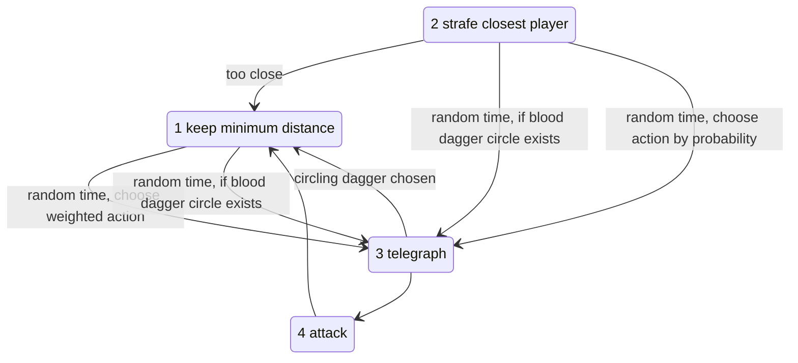

# Bosses

## Miniboss: Death High Priest (dungeon 1)

**Status:** Decided

**Who:** an elf, a hermit member of the death cult and its former leader (the former leader of the religion of death). A crazed elf, maybe the leader of the "Death Cult" (name pending). See [story.md](../story.md).

**The fight:** goblin waves coming out of holes in the wall.
- **Phase 1:** he has goblins that give him a shield and don't respawn. He throws daggers while he has the shield.
- **Phase 2:** when all goblins are gone, the shield is gone and new goblins start coming. While recharging, he occasionally kills goblins to cast attacks, until he has accumulated enough for his shield again.
- The sacrifice attacks are purple/red death-magic daggers. They only look different and otherwise work the same.

### Attacks

- Single swipe melee attack.
- Dagger cone.
- Needs a goblin sacrifice: 12 blood daggers in all directions, at the goblin's location.
- Needs a goblin sacrifice: 3 blood daggers circle a random player.
- Needs a goblin sacrifice: gain a shield.

### Movement

- Moves slowly, strafing the nearest player and trying to hold distance (weak priority to hold distance).
- Occasionally (or at certain HP damage) sacrifices a goblin to teleport.

### Behavior

### Weighted action choice

Point system: assign points to each action, then divide each action's points by the total to get its probability.

| Action | Rules |
|---|---|
| Melee swipe | has shield +5, too close +5, too far: set to 0 |
| Teleport | too close +5, no shield +5, far enough −5, no goblin: set to 0 |
| Dagger cone | too close and has shield +5, far enough +10, no goblin +5 |
| Dagger explosion | too close −10, has shield +5, far enough +10, no goblin: set to 0 |
| 3 circling daggers | too close −10, has shield +5, far enough +10, no goblin: set to 0 |
| Shield | too close −5, far enough +10, no shield +10, has shield: set to 0 |

**Open:** is it weird that the circling daggers appear before the sacrifice (during the channeling/telegraph)?

**Built:**
- [MiniBossDeathHighPriest.gd](../../Scripts/Enemies/MiniBossDeathHighPriest.gd) has 9 HP.
- The decision brain is [StateThinking.gd](../../Scripts/StateMachine/StatesEnemy/MiniBossDeathHighPriest/StateThinking.gd). It uses base weights plus distance and shield modifiers, close to the table above.
- Sacrifice attacks mark a minion when their telegraph starts and kill it when the ability goes off (`StateTelegraphSacrifice`).
- He teleports every time his HP drops to a multiple of 3.
- The whip does nothing to him, since it is found after this fight.
- In the map's MiniBossRoom:
  - The doors close once both players are inside.
  - An `EnemySpawner` brings goblins from 4 points.
  - When everything is dead, the whip chest appears and the door opens.
- Known bug: the dagger circling breaks when he is interrupted by damage (TODO in the script).

## End boss: dungeon 1

**Status:** Draft, still in discussion

**Concept:** a creature born from the living beings the players killed in this dungeon. This is the chalice idea that "enemies come back as one big dungeon monster at the end of each dungeon run" ([items.md](items.md#chalice-of-death)).

**Lore:** nobody dies a natural death anymore since the death god is gone. Beings killed by violence or accidents become Severed, monsters that reflect their defining aspects. The end boss is the Severed born from this dungeon's dead.

**Open:** how exactly the boss is created or appears is not decided yet.
- Rejected: the dead bodies crawling together and fusing into one.

### Proposals

**Status:** Draft

- **Arena:** the chief room behind the 2nd locked door (concept sketch: "chief room, bossfight?"). The lever that opens the dungeon exit becomes usable after the fight.
- **Built from what was killed in the run,** reusing those enemies' attacks:
  - goblins: claw swipes; spits out severed goblins
  - wizards: fireball volleys
  - Death High Priest: blood dagger cone, circling daggers
  - elite wizard: short teleports
  - more kills = more HP
- **Sheds what it absorbed:** at HP thresholds a part breaks off as a minion and its attacks disappear, so the boss gets smaller and simpler during the fight.
- **Weak core** covered by body parts. The whip tears a part away to expose the core; player 2 shoots the core from range while player 1 keeps the boss busy.
- **Ending:** the chalice choice, saved for later dungeons:
  - kill it with the chalice: a reward, but the death god grows stronger (bad ending path)
  - entrap it: no reward, some monster outbreaks later (good ending path)

### Open questions

- Scripted tutorial death at the boss (the chalice revives the players through the underworld)? Needs the death / revive loop first.
- Reward for killing it with the chalice: an ability, an extra heart, nothing yet?
- Most rooms lock until cleared, so kill counts barely differ between runs in this dungeon.
