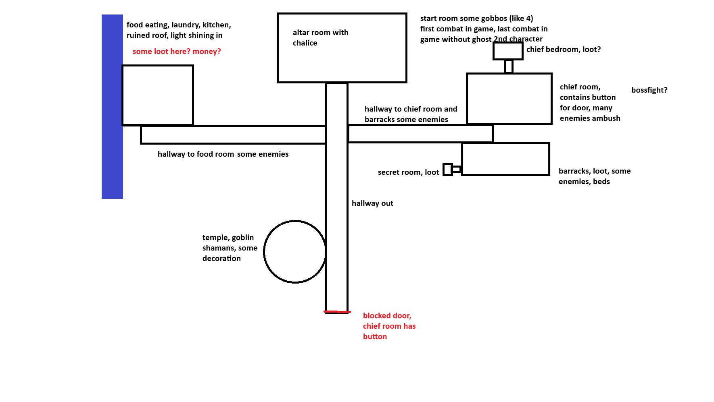

# Dungeon 1: the goblin jungle dungeon (tutorial)

## Concept

**Status:** Decided

- Tribal orc / goblin dungeon with nature magic.
- 8–12 rooms.
- The dungeon item (the whip) at around half the rooms.
- Dungeon keys.
- Exploration and loot.
- A miniboss guards the item ([bosses.md](bosses.md#miniboss-death-high-priest-dungeon-1)).
- Serves as the tutorial / starter dungeon.

## Concept layout

**Status:** Idea (concept sketch; the built map differs)

- **Altar room with the chalice** (start room): some goblins (about 4). The first combat in the game, and the last combat without the ghost second character.
- **Hallway out:** the central hallway. It ends in a **blocked door**; the chief room has the button that opens it.
- **Hallway to the food room:** some enemies. Leads to the **food room**: eating, laundry, kitchen, a ruined roof with light shining in. Some loot here, maybe money.
- **Hallway to the chief room and barracks:** some enemies.
- **Chief room:** contains the button for the exit door, many enemies ambush ("bossfight?"). Next to it the **chief bedroom** (loot?).
- **Barracks:** loot, some enemies, beds. Next to it a **secret room** with loot.
- **Temple:** goblin shamans, some decoration.
- A water strip runs along the left side of the sketch.

## Built map

**Status:** Built. The scene is [DraftJungleDungeon.tscn](../../Scenes/World/Maps/DraftJungleDungeon.tscn), which is also the main scene.

| Room | Contents |
|---|---|
| ChaliceAltarRoom | start room: 2 goblins, 2 wizards, the chalice altar |
| MainHallway | central hallway: 2 goblins, 3 wizards; two locked doors; the exit lever and `DungeonExit` at the bottom |
| FoodHallway | 2 goblins |
| FoodHallway2 | 2 wizards |
| FoodRoom | money chest, fireplace, water |
| Barracks | 4 goblins, money chest |
| PuzzleRoomHallway | goblins, wizard |
| PuzzleRoom | slippy box push puzzle (player 1 pushes, player 2 toggles blocks); solving it opens the door |
| PuzzleRoomReward | small key chest |
| MiniBossHallway | 2 goblins, `HiddenChest` (contains nothing yet) |
| MiniBossRoom | Death High Priest + goblin waves; whip chest appears when cleared |
| WhipPuzzleRoom | lever that opens a door (pull it with the whip) |
| RuinedDormitoryHallway | goblins, wizards; leads to 4 small dormitory rooms |
| RuinedDormitoryTopLeft / TopRight / BotLeft / BotRight | empty so far |
| RuinedDormitoryBig | elite wizard; small key chest appears when it is defeated |
| Area behind MainHallway's 2nd locked door | the lever that opens `DungeonExit`; planned end boss arena ([bosses.md](bosses.md#end-boss-dungeon-1)) |

Systems the rooms use:
- **Rooms** ([Room.gd](../../Scripts/World/WorldObjects/Room.gd)): enemies idle until the room wakes up; boss rooms wake only when both players are inside.
- **Doors:** `Door` (interact, optionally locked with a key) and `DoorTrigger` (opened by signals from levers, puzzles and cleared rooms).
- **Enemy waves:** `EnemySpawner`, with `EnemyCounter` signalling when a room is cleared.
- **Enemy pathfinding:** `EnemyNavigation`, which rebakes when doors open or close.

**Open:**
- Walking through `DungeonExit` doesn't finish the dungeon yet.
- The players can't die yet (`EventBus.playerDied` has no listener).
- The four small dormitory rooms are empty.
