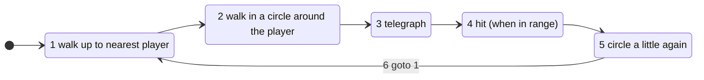
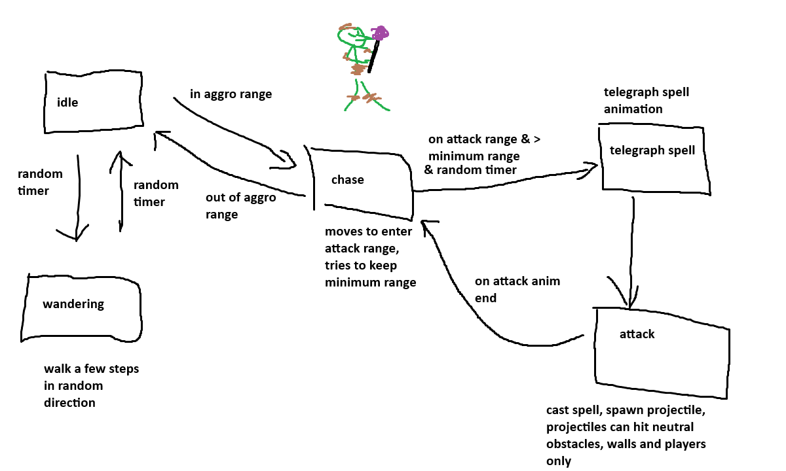
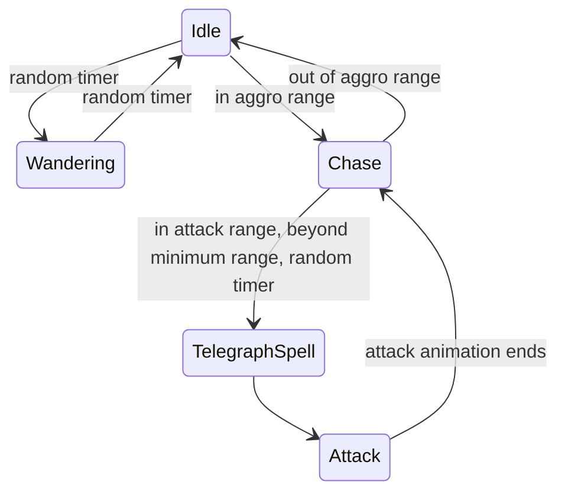
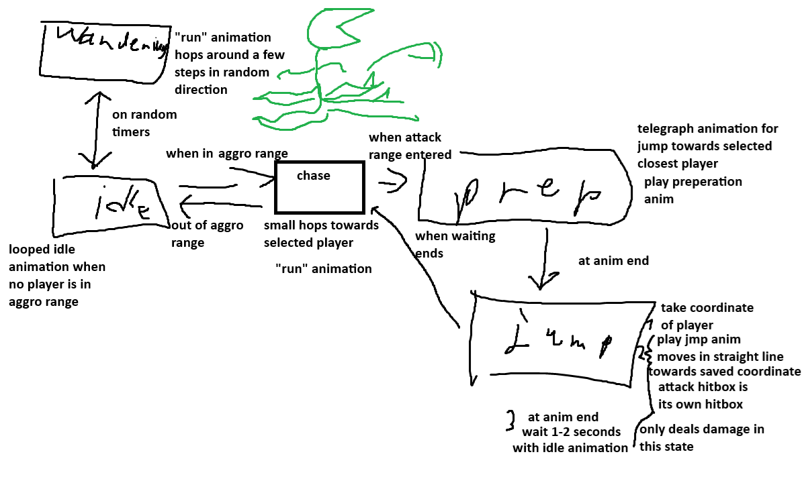
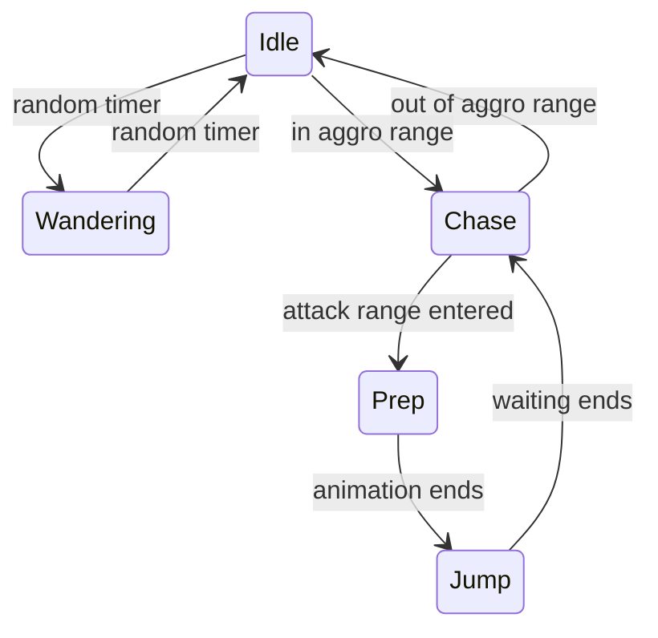

# Enemies

Bosses are in [bosses.md](bosses.md).

## Overview (built)

Values from the enemy scenes in `Scenes/Enemies/`. Rooms in the map can override them (for example, most wizards in the first dungeon have `atkRange = 500`).

| Enemy | Scene | HP | Attack range | Aggro range | Attack |
|---|---|---|---|---|---|
| Goblin | `Goblin.tscn` | 3 | 125 | 1000 | melee, 1 damage |
| Goblin wizard | `Wizard.tscn` | 3 | 400 | 500 (default) | `Fireball`, 2 damage |
| Elite wizard | `EliteWizard.tscn` | 3 | 800 | 800 | `Fireball`, 2 damage, teleports |

All enemies share [Enemy.gd](../../Scripts/Enemies/Enemy.gd):
- They follow the navigation mesh around walls and world objects ([EnemyNavigation.gd](../../Scripts/World/EnemyNavigation.gd)).
- They pass through each other but keep some distance.
- They stay idle until their room wakes up.
- The whip stuns them for 1 s.

## Goblin

**Status:** Decided

- Hits at random time intervals, which looks more natural with swarms of goblins.
- 1–2 hits HP.

**Built:** `StateRunGoblinMelee` and `StateRunCircleGoblinMelee`, with 3 HP (the design says 1–2 hits).

## Goblin wizard (mage / ranged)

**Status:** Decided

1. Stay in range of the nearest player.
2. Run away when a player is in melee range.
3. Shoot when in range.
4. Move a little after a shot.
5. Go to 1.

- 1 HP.

**Built:**
- Uses [StateRunEliteWizard.gd](../../Scripts/StateMachine/StatesEnemy/EliteWizard/StateRunEliteWizard.gd) (the older `StateRunGoblinWizard.gd` with the run-away behavior is not used by any scene).
- Only fires when a fireball-sized sweep to the player is clear.
- While blocked, each wizard walks to its own firing spot around the player, so groups spread out. Once it has a clear shot it stays put.
- 3 HP (the design says 1).

### Goblin shaman concept

**Status:** Idea (concept sketch)

- **Wandering:** walk a few steps in a random direction.
- **Chase:** move into attack range, but try to keep a minimum range.
- **Telegraph spell:** play the telegraph spell animation.
- **Attack:** cast the spell and spawn a projectile. Projectiles can only hit neutral obstacles, walls and players.

## Elite wizard

**Status:** Decided (as built)

A wizard that teleports between fixed spots (`teleportLocationsRoot`):
- When hit, it teleports and taunts.
- When hit while stunned, it takes damage and gets slower: telegraph and attack each take 0.2 s longer.
- Guards the key in the first dungeon's RuinedDormitoryBig.

**Built:** [EliteWizard.gd](../../Scripts/Enemies/EliteWizard.gd).

## Piranha plant

**Status:** Idea

1. Move toward the nearest player with jumping movements.
2. Telegraph a bite.
3. Bite.
4. Go to 1.

- 1 HP, maybe 2.

### Plant monster concept

**Status:** Idea (concept sketch)

- **Idle:** looped idle animation while no player is in aggro range.
- **Wandering:** "run" animation, hops a few steps in a random direction.
- **Chase:** small hops toward the selected player ("run" animation).
- **Prep:** telegraph animation for a jump toward the selected closest player.
- **Jump:**
  - Takes the player's coordinate, plays the jump animation and moves in a straight line toward the saved coordinate.
  - The attack hitbox is its own body hitbox, and it only deals damage in this state.
  - At the animation's end it waits 1–2 s with the idle animation.
