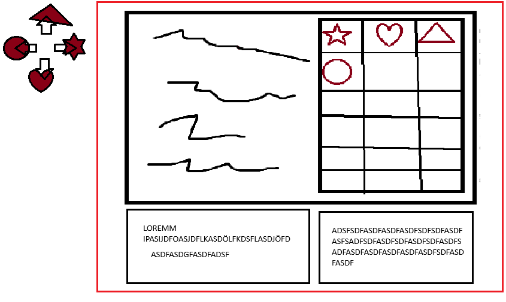

# UI

## Dungeon map

**Status:** Decided

- Maps exist only in dungeons. Elsewhere there is just a fancy image with the approximate location.
- The dungeon map automatically draws the rooms that were discovered.

**Built:**
- A page of the pause menu ([GameUI.gd](../../Scripts/UserInterface/GameUI.gd)).
- Rooms show up once visited (`GameSession.seenRooms`), and the current room is highlighted. Each room's node name must match its sprite in the menu map ([Room.gd](../../Scripts/World/WorldObjects/Room.gd)).

## Pause menu

**Status:** Built

- Pause opens and closes it. Interact goes to the next page and block to the previous one.
- Pages: inventory, map, and a third page (`UI3`, empty so far).

## Inventory and quick slots

**Status:** Decided (as built)

- The inventory is shared by both players and lives in `GameSession` (it ends up in the save file later).
- Each player has 4 **quick slots** (bottom, top, left, right) for equippable items, used with their own quick slot buttons (see [players.md](players.md#controls)).
- In the inventory page, each player moves their own cursor (player 1 blue, player 2 red) and assigns the selected item by pressing a quick slot button.

Concept sketch (the text in the sketch is placeholder):
- quick slots as four shapes around a cross (top, left, right, bottom)
- an item grid on the right
- a description box below for each player

## Health

**Status:** Built

Each player's hearts are shown in the HUD ([HealthUI.gd](../../Scripts/Players/HealthUI.gd)), made of half-hearts: 6 HP = 3 hearts.

## Main menu

**Status:** Open

Not built. The game starts a new session directly (`GlobalStates.startNewGame()` has a TODO to call it from a main menu).
